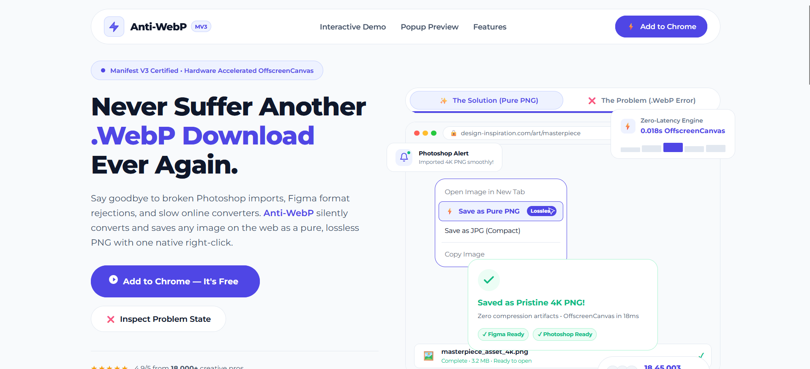
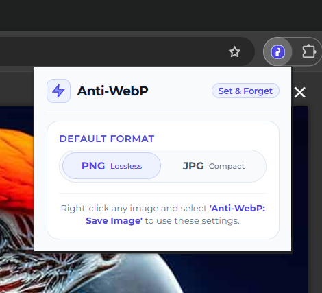

# ⚡ Anti-WebP Image Saver

<!-- 📸 PLACEHOLDER: Insert your 1400x560 Chrome Web Store marquee banner here -->


A frictionless, Manifest V3-certified browser extension that silently converts frustrating `.webp` and `.avif` images into pristine, lossless PNGs or high-quality JPGs with a single right-click.

[](#)
[](#)
[](https://opensource.org/licenses/MIT)

---

## 🚀 The Problem vs. The Solution

### ❌ The WebP Hassle
Modern web formats like `.webp` are highly optimized for bandwidth but create massive friction in creative workflows. Saving these images natively often breaks imports in **Figma, Adobe Photoshop, Illustrator, and Premiere Pro**, forcing designers and developers to rely on slow, ad-ridden online file converters.

### ✨ The Pure PNG Solution
Anti-WebP intercepts the download and processes the image locally, acting as a seamless bridge between the modern web and your native design tools.

<!-- 📸 PLACEHOLDER: Insert a quick 3-5 second GIF here showing the right-click menu and the "Save As" dialog appearing -->


## 💎 Key Features

* **"Set & Forget" UX:** Configure your preferred output format (Lossless PNG or Compact JPG) just once in the extension popup.
* **Native Context Menu Integration:** Adds a single, unobtrusive **"Anti-WebP: Save Image"** button to your right-click menu.
* **Instant Native Downloads:** Bypasses messy drag-and-drop interfaces by immediately triggering the browser's native "Save As" dialog so you can name and route your files exactly where they belong.
* **Smart Extension Stripping:** Automatically sanitizes messy URLs and strips the old `.webp` or `.avif` extensions to prevent double-extension formatting errors.

<!-- 📸 PLACEHOLDER: Insert a side-by-side screenshot of your Glassmorphic Popup UI here -->


## 🧠 Technical Architecture

This extension was engineered strictly for performance, privacy, and modern browser compliance.

* **Manifest V3 Certified:** Built using the latest Chrome extension security and background-execution standards.
* **Hardware-Accelerated Conversion:** Bypasses legacy DOM restrictions by utilizing the modern `OffscreenCanvas` API and `createImageBitmap()` directly within the background service worker. This enables zero-latency conversions (averaging ~18ms) without locking up the browser's main UI thread.
* **100% Client-Side Privacy:** No data is ever transmitted to an external server. The image fetching, canvas rendering, and blob conversion happen entirely on your local machine's memory.

## 🛠️ Local Installation (Developer Mode)

To run this extension locally or contribute to the source code:

1. Clone this repository:
   ```bash
   git clone https://github.com/technospes/anti-webp-extension.git
   ```
2. Open Google Chrome and navigate to `chrome://extensions/`.
3. Enable **Developer mode** using the toggle in the top right corner.
4. Click the **Load unpacked** button.
5. Select the `extension/` directory from the cloned repository.
6. Pin the extension to your toolbar, configure your default format, and right-click any image to test!

## 🔒 Privacy & Security

Anti-WebP requires the `<all_urls>` host permission strictly to fetch cross-origin image blobs into the local service worker for canvas processing. The extension tracks zero analytics, injects zero tracking cookies, and operates completely offline once the image payload is fetched.

---

Developed by **Ayush Shukla** · [GitHub Profile](https://github.com/technospes)